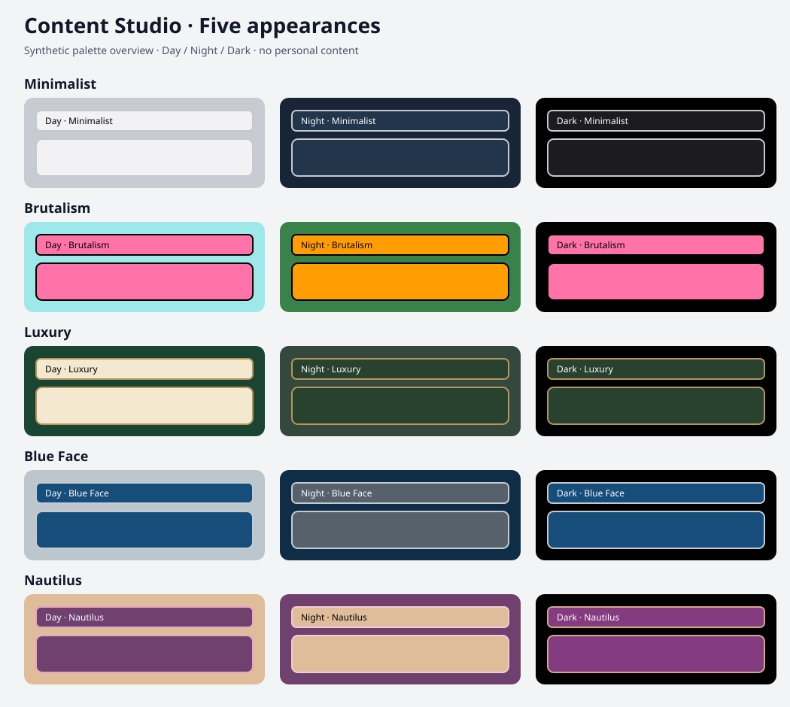

# FreshRSS için Content Studio

[English](README.md) · Türkçe

**Haberler, YouTube, Bültenler ve Bloglar** için tek eklenti. Minimalist, Brutalism, Luxury, Blue Face ve Nautilus temalarının her birinde **Gündüz, Gece ve Dark** bulunur. Görünüm seçicisi, temanın kaplama rengi ve köşe biçimiyle çevrilidir.

## Amaç

Kaynaklarını tek yerde toplarken her içerik türünü rahatça okuyabileceğin veya izleyebileceğin bir alan sunmak: haberlerde kompakt akış, uzun yazılarda yan panel, videolarda FreshRSS içinde izleme. Kendi aboneliklerini yönettiğin, farklı temalarla kişiselleştirebildiğin sade bir okuma alanı.

## Neler var?

Kapaklı ve kompakt akış, haber gruplama, konu/favori/kaynak simgeleri, tek açık yazı, Bloglar ve Bültenler için yan panel, akış içinde haber okuma, gömülü YouTube izleme ekranı, makale içi görseller ve videolar, düzgün kaydırılabilen tablolar, isteğe bağlı tam metin, Linkding ve seçerek MeTube indirmesi.

Eklenti arayüzü ile ayarları Türkçe, İngilizce, Almanca, Fransızca, İspanyolca ve Basitleştirilmiş Çince destekler. Yazıları çevirmez; FreshRSS'in kendi menülerinin dilini de FreshRSS belirler.

## Kurulum

[Sürümler sayfasından](https://github.com/emrebasaran1/freshrss-content-studio/releases) kurulum ZIP’ini indir ve aç. İçindeki eklenti klasörünü kullan.

1. `xExtension-ContentStudio` klasörünü FreshRSS'in `extensions` klasörüne kopyala.
2. **Ayarlar → Eklentiler → Content Studio** üzerinden etkinleştir ve ayarlarını aç.
3. Dört bölüm için kendi mevcut kategorilerini seç. Her bölüm farklı bir kategoriyle eşleştirilir; boş olan gösterilmez. Kaynaklarını FreshRSS üzerinden eklemeye devam et.
4. Kaydet, akış sayfasını yenile, tema ve modu seç.

FreshRSS **1.30.1** üzerinde denendi. PHP 8.1+, DOM, mbstring ve cURL gerekir. Normal/okuma görünümünü kullan. Genel görünümde geliştirilmiş kartlar desteklenmez. Aynı kategorilerde Youlag veya başka yerleşim eklentilerini kapat; bu paket Youlag'a bağlı değildir.

## İsteğe bağlı özellikler

- **Linkding:** kendi yeni bağlantı sayfası adresini gir. Kaydetme düğmesi seçtiğin yazının adresini ve başlığını Linkding'e açar. Hesap oturumu Linkding'de kalır.
- **MeTube:** kendi adresini gir. İndirme yalnızca sen videoyu ve kaliteyi seçip onayladığında başlar. CORS veya aynı kaynakta ters vekil gerekir. MeTube canlı servis bağlantısı sürüm testinde denenmedi. Çözünürlük seçimi üst sınırdır; kaynakta bulunmayan kalite üretilmez.
- **Tam metin:** varsayılan kapalıdır. Açıp kaynakların tam alan adlarını izin listesine ekle. Yönlendirmeler başka alan adına gidiyorsa ona da izin gerekir. Yalnızca açık HTTPS içerik alınır. Kaynaklara göre XPath seçilebilir; alan adına göre JSON eşlemesi de desteklenir. Örnekler [İngilizce rehberde](README.md).
- **Filtre:** istenmeyen ve ilgi ifadeleri boş başlar; kendi ifadelerini virgülle ekle. İlgi ifadesi, istenmeyen ifadenin önüne geçer. Filtreler yazıları silmez.

Haberlerde tam metin düğmeyle alınır. Bloglar ve Bültenler'de özellik açıksa yazı açılınca alınır. Hata olursa mevcut akış içeriği korunur. Sonuç 24 saat önbelleklenir. Abonelik çerezleri veya kişisel hesap bağlantıları bu pakette bulunmaz; ücretli içeriğin tamamını getirme garantisi yoktur.

## Bilinmesi gerekenler

Haber gruplama yalnızca yüklenmiş kayıtların başlıklarını karşılaştırır. Tarihler varsa 36 saatlik pencere kullanır. Yapay zekâ değildir; farklı anlatılmış aynı haberi kaçırabilir veya yanlış eşleştirebilir. Diğer kaynaklar düğmeyle görülebilir. Tek kaynak görünümü ve arama sonuçları gruplanmaz.

Video oynatımı kaynağın gömmeye izin vermesine, tarayıcıya ve içerik engelleyicilere bağlıdır. Kanal simgesi için FreshRSS'in mevcut kaynak simgesi kullanılır. Telefonun YouTube engelleme kuralları bu paketin parçası değildir.

Sunucu adresi, hesap, çerez, anahtar, özel akış, veritabanı, çalışma önbelleği veya araştırma/piyasa modülü içermez. Otomatik indirme, zamanlanmış arama, telemetri ve harici yazı tipi yoktur.

## Kaldırma

Eklentiyi kapat, sonra klasörünü kaldır. Kaynaklar, yazılar, favoriler ve kategoriler korunur. Tarayıcı görünüm tercihleri `content-studio-theme` ve `content-studio-tone` anahtarlarında tutulur. Yazıların tam metin önbellekleri, yazılar temizlenene kadar kalabilir.

## Yayına hazırlık

Test ve sınırlar için [TEST-REPORT](docs/TEST-REPORT.md), GitHub'a yükleme adımları için [RELEASING](docs/RELEASING.md) dosyalarına bak. Ana klasörü GitHub deposu olarak yükle; FreshRSS'e kurarken yalnızca `xExtension-ContentStudio` klasörünü kullan.

Lisans: GPL-3.0-or-later. [Youlag](https://github.com/civilblur/youlag) kullanım fikrine ilham verdi; bu paket Youlag'ın kod paketini veya görsellerini içermez. Saat markalarıyla bağlantılı değildir.
